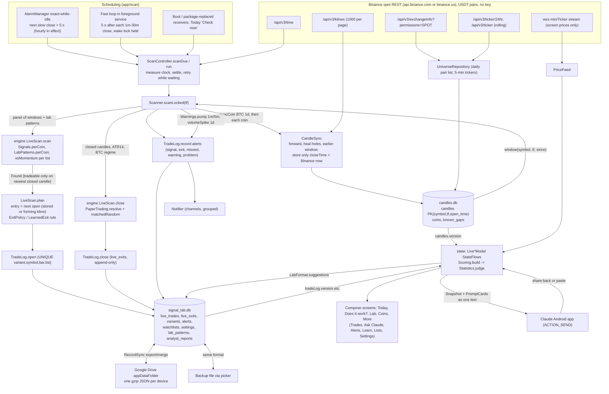

# Signal Lab Android: engine and architecture audit

Phase 1 of the engine overhaul. Read-only: nothing in the app was changed to produce this document.

- Repository state: branch `main` at `acb96f3` (Release 1.7.0), working tree clean apart from the untracked `review/` folder (the previous code review, whose 24 applied items are listed in `review/00-INDEX.md`).
- Date: 2026-10-14.
- Method: every file under `engine/` (source and tests), `app/src/main`, `app/src/test`, the Learn pages, the chart page, build and CI files, `tools/` and `review/` was read in full. The engine module was read line by line by the author of this document; the three app layers (data, scan/state/sync/update, UI/analyst) were read in full by delegated readers whose notes carry `file:line` references, and the claims that become findings below were re-checked against the source. The engine test suite was run: 153 tests, 0 failures, 45 s.
- Anything that could not be confirmed from code alone (device behaviour, Binance's live limits, timings) is marked **UNVERIFIED**. Nothing in this document is a guess filled in from a function's name.

Paths: `engine/...` means `engine/src/main/kotlin/com/ikverse/signallab/engine/`; `app/...` means `app/src/main/kotlin/com/ikverse/signallab/`.

---

## 1. What the app is

A native Kotlin and Jetpack Compose app (minSdk 29, targetSdk 36) that watches the coins in the user's active watchlists on Binance spot, turns every signal from a fixed set of long-only patterns into a **paper trade** that enters at the next candle's open, follows each trade on closed candles to a target, stop, trailing stop or time limit, compares every trade with 20 random entries on the same coin in the same BTC regime with the same exit, and keeps a scorecard with cluster-robust t-statistics and a Holm correction across every variant ever tried. A **Pattern Lab** lets the user (or Claude, through a share-sheet hand-off to the Claude Android app) define new patterns in a small fixed vocabulary; those are backtested for reference and forward-tested live. No real money, no exchange keys, no server of its own.

The research behind it was a retired Python project (`ikverse/Signal-Lab`); its exact signals, paper trades and statistics on real candles are frozen as golden test data and the Kotlin engine reproduces them to 1e-9.

---

## 2. Architecture map

### 2.1 Modules and layers

| Layer | Where | What it owns | Dependencies |
|---|---|---|---|
| **Engine** | `engine/` (2 335 lines, plain Kotlin, JVM 11, `allWarningsAsErrors`) | candles and clock, indicators, signals, lab patterns, exits, paper trading, random baselines, statistics, scorecard, live-scan rules, warnings, watchlist rules, variant labels | none (cannot see the Android SDK) |
| **Data** | `app/data/` | `BinanceClient` (REST), `CandleStore` (`candles.db`), `CandleSync`, `HistoryManager`, `UniverseRepository`, `WatchlistRepository`, `RecordDatabase` (`signal_lab.db`), `TradeLog`, `LabStore`, `ReportLog`, `SettingsStore`, `Costs` | engine, OkHttp 5.5, raw `SQLiteOpenHelper` (no Room) |
| **Scan** | `app/scan/` | `ScanController`, `Scanner`, `ScanService` (foreground), `AndroidAlarms`, `Receivers`, `ScanHealth`, `Notifier`, `AlertText`, `PriceFeed` (WebSocket, screen only), `PermissionFlow` | data, engine |
| **State** | `app/state/` | `AppGraph` (hand-written composition root), `LiveAppModel` and one `Live*Model` per screen contract, `Scoring`, `LiveAnalystModel`, `LearnCatalog`, `FileExchange`, `LiveDebugState` | data, scan, sync, update, engine |
| **Sync** | `app/sync/` | Google Drive `appDataFolder` sync: `RecordSync` (export/merge), `SyncEngine`, `DriveFolder`, `DeviceSync` | data, Play Services auth |
| **Update** | `app/update/` | GitHub-releases self-updater with signer verification | OkHttp |
| **Analyst** | `app/analyst/` | `Snapshot` (Markdown data file), `PromptCards`, `LabFormat` (pattern JSON), `ClaudeHandoff` (`ACTION_SEND`) | engine, data types |
| **UI** | `app/ui/` | Compose screens over interfaces in `ui/Contracts.kt`; a test forbids `ui/` from importing `data`, `scan` or `state`; hand-rolled `NavState`; two pooled WebViews (chart = KLineChart, Learn/report viewer = marked + Mermaid), all assets local, network blocked | engine (allowed), Compose |

Stack (from `gradle/libs.versions.toml`): Kotlin 2.4.10, AGP 9.2.1, Compose BOM 2026.02.01, coroutines 1.11.0, OkHttp 5.5.0, Play Services Auth 21.3.0, Robolectric 4.16 for tests. No DI framework, no ViewModel, no Navigation-Compose, no serialization library (`org.json`), no WorkManager.

### 2.2 Data flow

### 2.3 Threading and process model

- Application scope and the service scope are `Dispatchers.Default` with `SupervisorJob`. Every store method is `suspend`, hops to `Dispatchers.IO` and holds a per-store `Mutex` (`CandleStore` has **one global mutex** for all reads and writes, `data/CandleStore.kt:94-95`). `BinanceClient` does request, body read and parse on IO (review spec 02). No `runBlocking` in production code.
- Scanning runs one coroutine per due timeframe concurrently, each under a per-timeframe mutex (`scan/Scanner.kt:86,108`); `CandleSync` holds one mutex per (symbol, timeframe).
- UI collects `StateFlow`s with `collectAsStateWithLifecycle` (71 sites); derived flows use `mapLatest` + `stateIn(WhileSubscribed(5 s))` on the app scope.
- Remaining main-thread work: `AppGraph` construction and notification-channel creation in `Application.onCreate`; `LiveSettingsModel`'s initial permission queries (three binder calls); `ClaudeHandoff.installed` (package manager) per read of `claudeInstalled`.

---

## 3. Data sources, limits and how the app copes

### 3.1 Binance REST (`app/data/binance/BinanceClient.kt`, `DataConfig.kt`)

| Aspect | Behaviour | Evidence |
|---|---|---|
| Market and quote | Spot only (`exchangeInfo?permissions=SPOT`), **USDT quote only**; no futures, funding, open interest, order book or BTC-dominance data anywhere | `BinanceClient.kt:67`, `DataConfig.kt:17`, `UniverseRepository.kt:71` |
| Host | `api.binance.com`, or `api.binance.us` when the Settings switch is on; read per call | `DataConfig.kt:5-6`, `AppGraph.kt:67-70` |
| Clock | `/api/v3/time`, offset = server − midpoint of request; **re-measured before every scan pass**; a pass refuses to scan until the clock has been measured at least once; skew > 5 s raises a problem alert | `BinanceClient.kt:55-63`, `ScanController.kt:110-121,179-182` |
| Klines | `interval=<tf.label>`, `startTime`, `limit=1000` (always 1000, even for a one-candle hole); fields 0–6 parsed, the rest ignored | `BinanceClient.kt:103-112`, `CandleSync.kt:84` |
| Pacing | one request per 120 ms, enforced by a mutex held while sleeping (process-wide queue of about 8 req/s) | `BinanceClient.kt:175-179` |
| Weight guard | if `X-MBX-USED-WEIGHT-1M` > 4 800 the caller sleeps 30 s after the answer | `BinanceClient.kt:146-151` |
| Retries | 6 attempts; network and 5xx errors back off 0.5, 1, 2, 4, 8, 16 s; **429/418 sleep `Retry-After` (default 60 s) with no cap and no shared "banned until" state**; 451 = `Blocked`, no retry; other 4xx thrown at once | `BinanceClient.kt:135-172` |
| Timeouts | connect 15 s, read 30 s, no call timeout | `BinanceClient.kt:184-188` |
| Binance's documented limits (6 000 weight/min, klines weight, 418 ban length) | **UNVERIFIED** against current docs; only what the code assumes is recorded | |

### 3.2 Candle storage and the closed-candle rule (`CandleStore`, `CandleSync`, `HistoryManager`)

- `candles.db` v3: `candles(symbol, tf, open_time PK, open, high, low, close, volume, close_time) WITHOUT ROWID`, `INSERT OR IGNORE`, **never updated**; `coins` (pair list, offered/stable/delisted flags, listing date, 24 h figures); `known_gaps`. Deliberately excluded from backup and sync because it is re-downloadable.
- **Only closed candles are stored**: `closeTime < market.nowMs()` where `nowMs` is the phone clock plus the measured Binance offset. Binance's `closeTime` is `openTime + tf − 1 ms`, so the test is exact with no off-by-one (`CandleSync.kt:87`). The forming candle is returned to the scanner but never stored; its open is used as the entry price only when `forming.openTime == entryTime` (`Scanner.kt:281-285`).
- Sync algorithm per (symbol, tf) under its own mutex (`CandleSync.syncLocked`): (1) forward from `lastOpen + tf` (`startTime = lastOpen + 1`, inclusive, so nothing is re-fetched); (2) detect holes as consecutive stored open times more than `tf` apart, refill, and remember what stays empty in `known_gaps` so it is never asked again; (3) if the stored history starts later than the wanted window, fetch earlier once and remember a pre-listing stretch as a known gap. `now` is captured once per sync.
- History kept (`DataConfig.historyDays`): 1m 7 d, 5m 30 d, 15m/30m 60 d, 1h 100 d, 4h/1d 400 d; enforced only by a **daily trim**, which also drops timeframes no list uses (BTCUSDT daily is always kept for the regime). For a coin with an open trade older than the window, the scanner asks for `entryTime − (randomWindowDays + 1)` days so the entry candle and its baseline window exist (review spec 09); the daily trim deletes that stretch again, so it is re-downloaded once a day until the trade closes.
- Staleness: `HistoryManager.isReady` = newest open time at most two closed candles behind; the scanner always syncs forward before reading; `LiveScan.regimeIsCurrent` refuses to stamp a regime when BTC daily is not current; if BTC daily cannot be refreshed, **no trade on any timeframe can close** until it is (`Scanner.kt:184`), and nothing names that cause specifically.
- Time: everything is epoch milliseconds as Binance serves them (UTC-aligned); no zone code anywhere; `CandleClock` uses integer division by `tf.ms`.
- Exchange errors: a `BinanceException` propagates out of `CandleSync` after the pages already stored are committed; `HistoryManager` records the failure per coin and continues (only `Blocked` stops the run); the scanner records per-coin failures and scans what is stored, holding the cursor back one candle while anything is waiting so the newest candle's signal is still tradeable on the retry.
- Exchange differences: only `.com` vs `.us` hosts; same endpoints assumed. **UNVERIFIED** that Binance accepts the URL-encoded JSON `symbols=[...]` parameter exactly as OkHttp encodes it (tested against MockWebServer only), and that `klines(startTime=0, limit=1)` returns the first-ever candle (used for listing dates).

### 3.3 Universe and pickers (`UniverseRepository`, `CoinFilter`)

Pair list refreshed daily (`exchangeInfo` + `ticker/24hr`, read fully into memory as a string then an `org.json` tree); tickers refreshed every 5 minutes; rankings by volume, 24 h/1 h/7 d change (rolling window endpoint, batches of 100, cached 2 min), trade count, volatility, and new listings (30 d). `CoinFilter` hides pegged bases (fixed list), leveraged tokens and anything whose 24 h range sits inside 0.97–1.03; a coin is also marked stable after 30 daily closes inside that band and then skipped by the history download. The `offered` flag is recomputed only daily.

### 3.4 Costs (`app/data/Costs.kt`)

Live round trip = `2 × fee_per_side` (default 0.10 % each way, so **0.20 %**) + an optional extra for BTC/ETH or for other coins (default 0). The research figures of 0.25 %/0.40 % survive only as `EngineConfig.COST_MAJORS/COST_OTHERS`, used by the golden backtest and as the fallback for trades recorded before the cost column existed. Each trade stores the cost it was charged. **The sentence in `CLAUDE.md` ("Costs: 0.25 % round trip for BTC and ETH, 0.40 % for everything else") no longer describes the live default.** No spread or slippage is modelled unless the user turns the extra on.

### 3.5 The record database (`signal_lab.db`, schema v6)

`watchlists`, `watchlist_coins`, `settings(key, value, updated_at)`, `live_trades` (UNIQUE `(variant, symbol, bar_time, list_id)`, with `cost`, `exit_mode`, `atr`), `live_exits` (one per trade: exit, gross, net, random_mean, excess, max_up, max_down, bars_to_peak), `alerts` (never pruned), `variants` (every variant ever registered: the multiple-testing denominator), `analyst_reports`, `lab_patterns` + `lab_stops`, `watchlist_tombstones`. `live_trades`, `live_exits`, `variants`, `lab_patterns` and `lab_stops` have `BEFORE UPDATE/DELETE` triggers that abort: the record is append-only by construction. Lists, lab patterns and reports carry a `sync_id`; trades are identified across devices by their natural key.

---

## 4. The engine, function by function

The module is plain Kotlin; every number the rules depend on lives in `EngineConfig.kt` and a golden test pins the research-era values.

### 4.1 Candles and time (`Candles.kt`, `CandleClock.kt`)

| Item | Detail |
|---|---|
| `Timeframe` | `M1, M5, M15, M30, H1, H4, D1`; `ms`, `barsPerDay`, `isFast` (< 1h: scanned by the wake-locked loop, not an alarm). New lists default to `{15m, 1h, 4h}`; lists from before chart choice keep `{1h, 4h, 1d}`. |
| `Candles` | Parallel primitive arrays `t, open, high, low, close, volume, closeTime` for one symbol and timeframe. Only closed candles ever go in (`Candles.kt:37-40`). `slice(from, to)` copies ranges. |
| `lowerBound/upperBound` | numpy `searchsorted` left/right on sorted arrays. |
| `CandleClock` | `nextClose = (floorDiv(now, ms) + 1) × ms`, `lastClose = floorDiv(now, ms) × ms`, `closingAt(instant)`, `closesBetween(tf, after, upTo]`. Callers pass Binance's clock, never the phone's. |

`t` is the open time; `closeTime` is Binance's `close_time` (open + ms − 1). A signal's `detectedAt` is its candle's `closeTime`.

### 4.2 Indicators (`Indicators.kt`)

Each returns an array the same length as its input, `NaN` where history is insufficient; value *i* uses bars ≤ *i* only.

| Function | Formula | Notes |
|---|---|---|
| `sma(x, n)` | cumulative-sum difference / n, from index n−1 | A running total, not a sliding sum, so the arithmetic matches the Python research to the last digit (`Indicators.kt:16-18`). Cumulative sums of volume (~1e12) lose ~1e-4 absolute; negligible. |
| `rollingMaxPrior(x, n)` / `rollingMinPrior` | max/min of bars `[i−n, i−1]`, **current bar excluded** | O(n·window), no deque. |
| `ema(x, n)` | k = 2/(n+1), seeded with the SMA of the first n | Lab blocks only; start-dependent, as RSI is. |
| `rollingStd(x, n)` | population SD (divisor n) of bars `[i−n+1, i]` | O(n·window); with window 720 on 1h (the fade) this is the costliest indicator. |
| `trueRange` | max(h−l, abs(h−prevClose), abs(l−prevClose)); bar 0 uses its own close as prev | |
| `atr(h,l,c,n)` | **simple mean of the last n true ranges**, not Wilder's smoothing | Matches the research; differs from TradingView's RMA-based ATR. Drives every target, stop and trailing distance. |
| `pctReturn(close, lag)` | close[i]/close[i−lag] − 1 | |
| `rsi(close, n=14)` | Wilder: seeded with the simple average of the first n changes, then `(g(n−1)+up)/n` | Lab block only. |
| `crossedAbove(a,b)` | `a[i] > b[i] && a[i−1] <= b[i−1]` | NaN compares false, so it never fires early. |
| `quantile(values, q)` | numpy linear interpolation including its nearer-end rounding | Sorts a copy per call. |

Verified by `IndicatorsTest` (hand cases) and `GoldenTest.indicatorsMatchOnRealBitcoin` (BTC daily 2019–2026, 1e-9 relative).

### 4.3 The built-in signals (`Signals.kt`, `Candlesticks.kt`)

Contract (`Signals.kt:15-18`): a flag on bar *i* means "detected when bar *i* closed"; each rule reads bars ≤ *i*; `InvarianceTest` recomputes on truncated history and on history with a scrambled future and demands identical flags. Every signal is **long-only**. `firstBarOf(state)` turns a persistent state into one signal per run.

| Variant name | Family | Charts | Exact rule | Exit in the live scan (`ExitPolicy`) |
|---|---|---|---|---|
| `trend_ma20_<tf>`, `trend_ma50_<tf>` | `trend_state` | all 7 | close crosses above SMA(n) | TRAIL |
| `donchian10/20/55/100_<tf>` | `donchian` | all 7 | first bar of a run where close > highest high of the **prior** n bars | TRAIL |
| `tsmom1w/2w/4w_<tf>` | `ts_momentum` | 4h, 1d | w-week return ≥ its 80th percentile over the trailing 365 days; the percentile is recomputed only on UTC-midnight bars and held until the next (`rollingQuantileDaily`); needs ≥ 182 days of bars before any threshold exists; first bar of run | TRAIL |
| `fade1h/2h/4h_1h` | `big_move_fade` | 1h | k-hour return < −2.5 × rollingStd(k-hour returns, 720 bars) using the **previous** bar's SD so the move does not inflate its own yardstick; first bar of run | LEARNED |
| `fade1h_hold24_1h` | `big_move_fade` | 1h | same entry as fade1h, held 24 candles | HELD(24); **forward-only** (declared after a backtest hinted at a 24-hour bounce) |
| `intraday_mom_30m`, `intraday_mom_1h` | `intraday_momentum` | 30m, 1h | the UTC day's first candle rose and its return is ≥ the 80th percentile of the previous 90 days' first-candle returns (needs ≥ 45); flagged on the second-to-last candle of the day | HELD(1): enter at the last candle's open, exit at its close |
| `intraday_breakout_15m/30m/1h` | `intraday_breakout` | 15m, 30m, 1h | per time-of-day slot, "usual stray" = mean over the previous 14 days of abs(close/dayOpen − 1) at that slot; signal = first candle of a within-day run with close > dayOpen × (1 + usual); never the last candle of a day; any missing slot in the 14 days means no signal | TRAIL with an **end-of-day** cap |
| `bullish_harami_<tf>` | `candlestick` | all 7 | TA-Lib `CDLHARAMI` positive (100 or 50): long black candle (body > average of the 10 prior bodies) then a short candle (body ≤ average of the 10 prior) whose body is inside or touching | LEARNED |
| `bullish_hikkake_<tf>` | `candlestick` | all 7 | TA-Lib `CDLHIKKAKE` positive: inside bar, then a bar breaking down (lower high and lower low) is one flag, and the first close within 3 bars back above the inside bar's high is a second | LEARNED |
| `xsmom2w/3w_<tf>` | `xs_momentum` | 1h and slower; in practice 4h/1d | on every bar whose **open** is Monday 00:00 UTC, rank the list's coins by w-week return; the top ⌈20 %⌉ get a flag; skipped with < 8 coins; ties broken by symbol descending | TRAIL |

Which run where is `Signals.perCoin` (`Signals.kt:247-257`) plus `Signals.xsMomentum` per list. Lab patterns are added by `LabPatterns.perCoin`.

Notes from the reading:
- `xsMomentum` flags the bar that *opens* Monday 00:00, so on daily charts the ranking uses Monday's close and the paper trade enters at **Tuesday** 00:00 (on 4h at Monday 04:00). The code comment says "Every Monday 00:00 UTC bar"; the behaviour matches the research, but the wording in the Learn page should be checked against it.
- `rollingQuantileDaily` includes the midnight bar's own value in the window used for its own threshold (`Signals.kt:67-75`). Not look-ahead; mildly self-referential.
- `tsMomentum` needs about 182 days of 4h bars plus the 4-week lag before it can fire at all; the app keeps 400 days of 4h and 1d, so it can.
- There is **no volume, derivatives, order-book, BTC-dominance or multi-timeframe input to any built-in signal**. Volume is used only by the two market warnings and by lab blocks. Nothing is short-side.
- Several built-ins are strongly correlated by construction (trend_ma20 and donchian20 fire on the same breakouts; donchian10/20/55/100 nest), and one coin can hold one open trade **per variant** at a time, so a single move can open several paper trades on the same coin.

### 4.4 Exits (`Exits.kt`, `PaperTrading.kt`)

`ExitMode`: `CLASSIC` (research), `TRAIL`, `LEARNED`, `HELD`. `ExitRule` is expressed in ATR multiples so the same rule applies to a trade and to its random entries; `ExitSpec` is the rule resolved to prices.

| Rule | Levels | Time cap |
|---|---|---|
| CLASSIC | target = entry + 2·ATR14, stop = entry − 1·ATR14 | `timeLimitBars`: 1m 60, 5m/15m/30m 48, 1h 24, 4h 42, 1d 7 |
| TRAIL | safety stop entry − 2·ATR; once the highest close ≥ entry + 1·ATR the stop = max(stop, highestClose − 2·ATR), never lowered; the stop is checked against a candle's low **before** that candle's close can raise it | `trailCapBars`: 1m 120, 5m 72, 15m 96, 30m 48, 1h 72, 4h 90, 1d 30 |
| LEARNED | target = entry × (1 + median best rise of earlier finished signals), stop = entry − 3·ATR; time limit = ⌈median bars to peak⌉; falls back to a plain 6-candle hold with < 20 usable earlier signals (own coin first, then the whole list) or a median rise ≤ 0 | learned, ≤ `learnWindowBars` (1m 60, 5m–30m 48, 1h 24, 4h 18, 1d 7) |
| HELD | none | the variant's `hold_bars` |

Fill rules (`PaperTrading.resolve`, `simulateExits`): entry at the **next candle's open**; the stop is assumed first when one candle touches both; a gap through a level fills at the open; the time exit is the close of the limit-th candle. `simulate` (backtest) counts a trade only once its whole window exists; `resolve` (live) reports an exit as soon as it happened. `ExitsTest.simulateAndResolveAgreeForEveryModeOnRealCandles` holds the two equal.

End-of-day (`ExitPolicy.endsTheDay`): only `intraday_breakout_*`; `limitAt` shortens the cap to the candles left in the UTC day; `allowsSignalAt` refuses a signal on the last candle of a day.

`LearnedExit.outcomes` uses only signals whose whole look-ahead window had closed (`s + window < size`), and `rule` only those older than the window and newer than `learnLookbackDays` (1m 4, 5m 20, 15m/30m 40, 1h 60, 4h/1d 300). Tested for no look-ahead.

Observation: the learned target is the median maximum favourable excursion of past signals, so by construction about half of future trades should reach it, and the stop sits 3 ATR down. Expectancy therefore depends on the size of the losses, not the hit rate.

### 4.5 Random baselines (`Random.kt`, `Scorecard.matchedRandom`)

`Rng` is SplitMix64 as a pure function of `(seed, a, b)`; `seedOf(variant, symbol)` is FNV-1a. For each signal: pool = every bar on the same coin whose exit window fits inside the data, with a non-NaN ATR, allowed by the rule, and in the **same BTC regime**; window = ± `randomWindowDays(tf)` (1m 3, 5m–30m 10, 1h 30, 4h/1d 90 days); 20 draws per trade; every draw is simulated with the **same exit rule** and the same fixed horizons. `excess = net − mean(random nets)`.

`RandomBaselineTest` checks reproducibility, order-independence, uniformity, and that a signal firing on every bar has mean excess within 4 SE of zero on synthetic and on real BTC data. `RandomFingerprintTest` freezes the baselines on the golden candles.

Live difference (`LiveScan.close`): a live trade's baseline is drawn once, when it closes, from the candles that exist then, so random entries after the signal are only those whose window has already completed. The backtest's baseline sees the full ±window. Documented in the code and tested; it means live and backtest `excess` for the same trade can differ.

### 4.6 Regime (`PaperTrading.regimeSeries`)

1 if BTC's last **completed** daily close (`closeTime ≤ the trade's closeTime`) is above its 200-day SMA, 0 below, −1 before 200 days exist. Random entries are drawn from the same regime value.

### 4.7 Scorecard and verdicts (`Scorecard.kt`, `Statistics.kt`)

`Scorecard.runVariant`: one open trade per coin per variant at a time ("busy until" the previous exit); ATR14 per coin; exits by CLASSIC/HELD (golden mode) or `perPatternExits = true` (live mode); fixed horizons (`horizonBars`) net of cost; matched random per trade.

`Scorecard.score` per variant: `n`, `hit`, `randomHit` (share of all pooled draws > 0), `mean`, `median`, `randomMean`, `excess` (mean of per-trade excess), plain `t`, **`tCluster`** (`Statistics.clusterT`: cluster-robust t of the mean excess, clusters = `entryTime / 7 days`, with a g/(g−1) factor), one-sided `p = normalSurvival(tCluster)`, `profitFactor`, and details: tier, exit-reason counts, average bars held, **95 % cluster-bootstrap CI of the excess** (2 000 seeded resamples), per-horizon scores, per-regime mean excess, number of distinct weeks.

`Statistics.judge(scores, trials)`: Holm step-down and Benjamini-Hochberg across `m = max(trials, scores.size)`, where `trials` = **every variant ever registered on any timeframe** (missing p = 1). Verdict:

| Verdict | Condition |
|---|---|
| "Judged on live trades only" | `EngineConfig.isForwardOnly` (fade1h_hold24, every lab pattern); bypassed for live rows by `state/Scoring.kt` with a `"live:"` prefix, on purpose, because live trades are the one evidence such a pattern may be judged on |
| "No verdict" | n < 30 or tCluster NaN |
| "Edge" | tCluster ≥ 3.0 **and** Holm-adjusted p < 0.05 |
| "Losing" | tCluster ≤ −2.0 (uncorrected, deliberately easier) |
| "No edge" | otherwise |

Tiers by n: < 30 "No verdict", < 100 "Early read", < 300 "Provisional", else "Meaningful". BH q-values are computed but no verdict uses them.

### 4.8 The live-scan rules (`LiveScan.kt`)

- `scan(tf, panel, lists, after, now, lab)`: runs every per-coin signal and lab pattern on each coin's **whole window** and `xsMomentum` per list; reports flags on candles that closed after the cursor (first run: only the newest closed candle), never more than `MAX_LOOKBACK_BARS = 48` back; a found signal is `tradeable` only when it sits on the newest closed candle, otherwise it is "missed" and never traded. `Scan.variants` lists every variant that ran, fired or not.
- `Scan.ruleFor`: TRAIL/HELD from the pattern; LEARNED from that pattern's finished outcomes on this coin, then the whole list.
- `plan(...)`: null when ATR is NaN or an end-of-day rule forbids the signal; otherwise everything the exit will later need (mode, target, stop, atr, limit, `exitDue`, cost), so a trade can be judged later from the log alone.
- `close(...)`: `PaperTrading.resolve` on the stored spec; `matchedRandom` once with the stored rule; excursion (max up, max down, bars to peak).
- `regimeIsCurrent(btcDaily, now)`.

### 4.9 Lab patterns (`LabPatterns.kt`)

A pattern is data, never code: 1–4 conditions `left (above | below | crosses_above | crosses_below) right`, operands from `open, high, low, close, volume, sma(n), ema(n), rsi(n), atr(n), highest(n), lowest(n), return(n), volume_ratio(n), number`, n ∈ [2, 200]; exit `trail | learned | hold(1..200)`; one or more timeframes. Signal = first bar of a run on which **every** condition holds. Variant `lab<id>_<tf>`, family `lab`, always forward-only. Rationing: 10 running, 15 new per 30 days; a test stopped before 5 trades gives its slot back but still counts as a trial. `LabPatternsTest` runs hundreds of random patterns on truncated history and demands identical flags.

### 4.10 Market warnings (`Warnings.kt`): alerts only, never trades

`pump`: on 1m/5m, close/open over the last 5 minutes ≥ +5 % on ≥ 10 × the volume that coin normally trades in 5 minutes (over the previous 240 minutes). `volumeSpike`: daily volume > 3 × its 30-day average. Cooldowns 30 min and 20 h in the scanner.

### 4.11 Watchlist rules and coin filter (`Watchlists.kt`)

30 coins per list, 150 distinct active coins, 10 on 1m and 30 on 5m across all active lists; names ≤ 40 characters, unique ignoring case; `CoinFilter` as in §3.3.

### 4.12 How the engine is tested today

| Test | What it proves |
|---|---|
| `GoldenTest` (5) | indicators, every signal's flag positions, 20 000+ paper trades and their deterministic stats, the statistics functions and the config all equal the retired Python research on real candles: 12 coins daily 2019-01 → 2026-09, 4 coins 4h (2 years), 3 coins 1h (400 days) |
| `InvarianceTest` (8) | no repainting and no look-ahead on synthetic and real candles for all timeframes, plus a mutation test proving the check catches a peeking signal |
| `CandlesticksTest` (9) | TA-Lib parity on every golden candle (1m, 15m, 1h, 4h, 1d) |
| `ExitRulesTest`, `ExitsTest` (32) | every fill rule, trailing, learned, end-of-day, excursion |
| `RandomBaselineTest`, `RandomFingerprintTest` (7) | unbiased, reproducible, order-independent baselines; frozen fingerprints |
| `StatisticsTest` (8) | erfc, cluster t, bootstrap, verdict rules, more trials make an edge harder |
| `LiveScanTest` (30), `LabPatternsTest` (11), `WarningsTest` (10), `WatchlistRulesTest` (14), `CandleClockTest` (8), `IndicatorsTest` (11) | as named |
| app: `LiveEqualsBacktestTest` (4) | real candles replayed close by close through the real `Scanner`; every trade opened and closed equals the backtest's under live exits and costs, on 1d, 1h, 15m and 1m |
| app: `GoldenPipelineTest` | research candles served as Binance JSON → real client → `CandleSync` → SQLite → `Candles` → `Signals.compute` equal to the research bar for bar |

What **no test or report measures anywhere**: out-of-sample or walk-forward performance, parameter sensitivity, drawdown, expectancy per variant across regimes beyond the two-way BTC split, stability across periods, any pattern on data after 2026-10-01, or any coin outside the golden set. The golden tests prove the engine equals the research; they do not say the patterns work.

---

## 5. From a candle close to the user

### 5.1 Scheduling

- Charts of an hour and longer: one `AlarmManager` alarm (`setExactAndAllowWhileIdle`, inexact `setAndAllowWhileIdle` when the permission is missing) at the earliest upcoming slow close + 5 s, which is **hourly in effect**, and still hourly (defaulting to H1) when only fast charts are in use so the service is restarted if killed.
- Charts under an hour: a loop inside the special-use foreground service that holds a **partial wake lock continuously** and scans 5 s after each fast close, while "Follow charts under an hour" (default on) is set.
- Every pass: re-measure the Binance clock (refuse to scan if it was never measured), wait until 5 s past the minute, scan only timeframes whose cursor is behind, all due timeframes concurrently; retry up to 5 times every min(30 s, tf/4) while waiting for a first price, a current BTC regime or a failed download; arm the next alarm in `finally`; once a day trim history.
- Doze behaviour of the fast loop without the battery exemption, alarm lateness without exact-alarm permission, and whether an inexact alarm grants the Android 12+ foreground-service-start exemption are **UNVERIFIED** (no device was used).

### 5.2 The pass (`app/scan/Scanner.kt:110-272`)

1. Freeze `now`; load the active lists on this timeframe, the analysable coins and the open trades on it.
2. `since` per coin = history window, extended for an open trade's entry and baseline window.
3. Sync BTC daily first, then every coin (per-series mutex); record failures; `Blocked` fails all.
4. Read every coin's window from SQLite into seven new arrays; compute ATR14 and the regime series per coin **for this pass only** (nothing is cached between passes).
5. If the regime is current: close open trades via `LiveScan.close` and record exit alerts.
6. `LiveScan.scan` over the whole window of every coin; register every variant that ran (`variants` table).
7. For each find, in deterministic order: not tradeable → "missed" alert (inbox only); regime stale or no first price yet → retry; already open for that variant/coin/list → skip; else `LiveScan.plan` with the next candle's open (stored or forming) and the pattern's exit rule → `TradeLog.open` (unique key) → "opened" alert and notification.
8. Warnings on the newest candle (pump on 1m/5m, volume spike on 1d) with cooldowns.
9. Cursor = last close − 1, or one candle earlier while anything is waiting.

`PriceFeed` (WebSocket miniTicker) is screen-only; trades close only on closed candles at the next pass of their timeframe.

### 5.3 State and screens

`AppGraph` is built in `Application.onCreate`. `Live*Model`s derive `StateFlow`s from version counters (`tradeLog.version` bumps on **every** trade, exit or alert write; `candles.version`; `labStore.version`; `reports.version`; `settings.version` for synced keys) with `mapLatest` + `stateIn(WhileSubscribed(5 s))`. `Scoring.build` rebuilds the full scorecard from all trades on each bump. The same bump feeds `DeviceSync` (20 s debounce, at most one round per 5 min, each round a full export + gzip + SHA-256 even when nothing changed).

Screens (`ui/`): bar = **Today** (open setups as plain cards: "SOL has a setup", why, Entry price / Profit goal / Loss limit, record sentence, scan status + "Check now"), **Does it work?** (practice-account total, one verdict card per pattern in plain words, the numbers behind a toggle, a curve on wide screens), **Lab**, **Coins** (list with notes, warnings, sparkline, "Coins you might add"; chart with per-trade level overlays; details with open-trade cards), **More** → All trades (filters, groups per pattern, trade detail with worst-dip-to-best bar and "vs random"), Ask Claude, Alerts, Learn (27 pages), My coin lists, Settings (9 sections). Three width-only layout classes (< 560, < 820, ≥ 820 dp), resizable panes, foldable support. Every data screen except Lab and Analyst gates on a `loaded` flag. A test bans the words buy/sell/bought/sold from `ui/`, `state/`, the Learn pages, the lab vocabulary and the prompt cards; verdicts read Working / Not working / No better than guessing / Too early to tell.

### 5.4 The Pattern Lab today (`ui/LabScreen.kt`, `ui/LabDraft.kt`, `state/LiveAnalystModel.kt`)

- Views: Home (budget bar and sentence, "Build your own" / "Ask Claude for ideas" / "Start from an example", Ideas from Claude with a count, Live tests with a status pill and a 30-trade progress bar, Stopped), one Test page (sentence, "Show the code", live status, trades, "Try it on past data", stop with a 4 s confirm, "Copy and change"), Builder (pills for each condition part edited in place, chart tick-chips 5m–1d, exit choice, the sentence, "Try it on past data", "Start live test"), Ideas (every suggestion from every report).
- A pattern's canonical form is JSON `{"charts":[..],"when":[{"left","is","right"}],"exit":".."}`, written identically by the UI draft and by `LabFormat`, stored in `lab_patterns`, never edited.
- The backtest (`LiveAnalystModel.backtest`) runs the real `Scorecard.runVariant` with live exits over the stored candles of every coin in the active lists, per chart, on `Dispatchers.Default`, and returns coins, closed trades, hit rate, mean net, excess and cluster t per chart. The Lab tab shows one sentence per chart **without excess or t**; the Analyst's suggestion cards show a dense line with both. Always with the note that only live trades can judge it.
- What is missing or inconsistent (all with evidence in the UI notes): no title field in the builder (the name is the first condition); `LabBudgetUi` defaults are 5/5 although the engine allows 10/15, so the first frame and the tests show the wrong allowance; `ScoreRowUi.forwardOnly` is declared and **never read by any screen**, and the Learn page `pattern-lab.md` claims rows say "Lab, forward-only" when they say "Lab · title"; the builder offers 5m–1d but lists can watch 1m and a Claude suggestion on 1m is accepted; the vocabulary in `LabDraft` is a hand-kept duplicate of the engine's `LabBlock` enum with no test holding them equal; a plain number compared with `return(N)` must be typed as a fraction with no hint; backtest results are `remember`ed, not saveable, so a rotation discards them; Lab and Analyst have no loading gate; no confidence level, no definition-level stats, no comparison between patterns, no choice of asset for the backtest, no per-signal "why this fired" beyond one sentence per family.

### 5.5 The existing Claude hand-off (`app/analyst/`)

Six prompt cards (Weekly review, What's fading?, BTC regime check, Explain a trade, 1h vs 4h, Suggest 3 patterns). `PromptCards.prompt` = a plain-text preamble ("skeptical quantitative analyst", use only the numbers in the data, name the trade count behind every claim, under 30 is an anecdote, forward-only patterns are judged on live trades only, no instructions for real money, Markdown under 600 words, end with "What to watch next") + `Snapshot.build`: a Markdown data file with the method, watchlists, scorecard, lab patterns, recent vs earlier, BTC regime split, how trades ended, by coin, up to 50 open and 100 closed trades, and for "Explain a trade" the trade's facts plus up to 150 candles around it; hard cut at 100 000 characters because of the share-intent size. Sent as one `ACTION_SEND text/plain` to `com.anthropic.claude` (chooser fallback), **no file attachment** because the Claude app drops the text when one is attached. Nothing leaves the phone until the user taps Send in Claude. The answer comes back by share-in or clipboard paste; link-only shares are refused; the body is stored raw in `analyst_reports` and sanitised on read; fenced `signal-lab-patterns` JSON blocks become lab suggestions. The `AnalystModel` interface already isolates the screens from the transport, so an API-backed implementation can feed the same `keep()` pipeline. The Learn page `analyst.md` and the Settings data note promise "no AI of its own", "costs nothing extra" and "sends nothing about you anywhere else"; all would have to change with an in-app API.

A memory note from 2026-10-07 records that the user chose this hand-off **instead of** an API key because they did not want to pay for API usage. The present mission asks for an in-app Anthropic API layer with a user-supplied key; that reversal is the user's own and is noted here so the Phase 5 proposal addresses cost controls explicitly.

### 5.6 Sync, backup and updates

Drive `appDataFolder`, one gzip JSON per device, fingerprint-gated upload, modifiedTime-gated download; trades identified by their natural key, lists/labs/reports by `sync_id`, newest `updated_at` (phone wall clock) wins for lists and the four synced settings, tombstones for deleted lists, chart caps enforced on activation. Backup is the same export through the file picker. The updater reads GitHub's latest release, allows only GitHub hosts, checks exact size, package name, the full signer SHA-256 set against the installed app and `versionCode == tag`, then hands to Android's installer.

---

## 6. Observations carried into Phase 2

Not yet a ranked fix list (that is Phase 2's deliverable); these are the facts the ranking will start from, grouped, each with its evidence.

### 6.1 Correctness of the engine

Checked and found sound: no look-ahead or repainting in any built-in or lab signal (tested, including a mutation test); candle closed-ness exact; entry at next open; stop-first and gap-at-open rules consistent between backtest and live; learned exits never learn from an unfinished window; the regime uses only completed daily candles; baselines unbiased and order-independent; the record append-only. No off-by-one was found in the engine.

Points to weigh:
- **E1** ATR is a simple mean of true range, not Wilder's; fine, but it must be stated wherever ATR is shown or explained.
- **E2** `xsMomentum` enters on Tuesday 00:00 on daily charts (bar that opens Monday); verify the Learn and label wording.
- **E3** `rollingQuantileDaily` includes the bar's own return in its threshold window.
- **E4** `LiveScan.close` draws a live trade's baseline from a window truncated at close time, so live and backtest excess differ by construction (documented).
- **E5** `intraday_mom` holds one candle; with 0.20–0.40 % round-trip cost on a one-hour hold the cost alone is of the order of the expected move. Measured, not assumed, in Phase 3.
- **E6** No short-side patterns, no volume or derivatives inputs, no multi-timeframe confluence.

### 6.2 Statistical design

- **S1** No out-of-sample, walk-forward or holdout evaluation exists; all backtest numbers are full-history, and the only guard against post-hoc selection is the forward-only flag plus the Holm correction over the count of variants.
- **S2** Correlated variants on one coin can each open a trade on the same move (per-variant busy rule), so the practice account's total double-counts a single event; clustering by week handles it for the t-statistic but not for the headline total or the "setups" shown on Today.
- **S3** "Losing" is uncorrected and one-sided while "Edge" is corrected; deliberate asymmetry, worth stating in the UI.
- **S4** The random baseline uses 20 draws per trade; its own sampling noise is folded into the excess. Acceptable but a sensitivity check (50 or 100 draws) is cheap.
- **S5** The learned exit's target is the median past MFE; the hit rate is pinned near 50 % by design, so only expectancy and loss size can tell it apart from noise.
- **S6** The live default cost (0.20 %) models fees only; no spread or slippage unless the user turns the extra on. `CLAUDE.md` still states the research figures.
- **S7** Verdict thresholds (t ≥ 3, n ≥ 30, 80th percentile, 2.5 σ, 14 days, 2×/1× ATR, 10 bodies) are research-era constants with no sensitivity analysis in the repo.

### 6.3 Performance and battery (app)

- **P1** Every pass recomputes every signal, lab pattern, ATR and regime over each coin's **whole window** read fresh from SQLite (1m: 10 080 candles × up to 10 coins every minute; 5m: 8 640 × up to 30). The no-look-ahead invariant makes an incremental or cached evaluation possible; the app does not use it (`LiveScan.kt:81-93`, `Scanner.kt:163-173`).
- **P2** A continuous partial wake lock while any fast chart is followed (default on).
- **P3** `hasWork`, `timeframesInUse`, `lab()` and `CostModel.load` re-read the database several times per pass and per fast-loop iteration; one global mutex serialises every `CandleStore` call, including the chart's and the analyst's reads behind scans.
- **P4** Every alert write bumps `tradeLog.version`, which rebuilds the whole scorecard, trade list, alert list and coin rows while on screen and can trigger a Drive round (full export + hash) every 5 minutes.
- **P5** `rollingStd`, `rollingMaxPrior` and `rollingMinPrior` are O(n·window); fine today, worth a deque/Welford pass if windows grow.
- **P6** Five `OkHttpClient` instances; `exchangeInfo` held twice in memory; 1000-candle pages for one-candle holes; an uncapped `Retry-After` sleep while holding locks; offline history runs that can take hours (**UNVERIFIED** timing).

### 6.4 Behaviour bugs found in the app (each verified in source)

- **B1** `ScanHealth.lastProblem` is never cleared (no caller passes null, `finished()` leaves it), so Today's status line shows the last transient problem for the life of the process (`scan/ScanHealth.kt:29-43`, `state/LiveScanModel.kt:24`).
- **B2** With "Follow charts under an hour" off, the hourly alarm still scans fast charts and writes up to 48 "missed" alerts per coin and pattern per pass (`Scanner.kt:97-102,217-221`, `LiveScan.kt:74-78`). Product question as much as bug.
- **B3** If BTC daily cannot be refreshed, no trade on any timeframe can close and nothing names that cause (`Scanner.kt:184`).
- **B4** `LabBudgetUi` stale defaults 5/5 vs engine 10/15; `ScoreRowUi.forwardOnly` unused; Learn page claims a label the rows do not show.
- **B5** Backtest result lost on rotation; Lab and Analyst show empty states before the first read.
- **B6** `ReportLog.add` ignores an insert failure (returns −1 as the id); `alerts` is never pruned; `TradeLog.addAlert` and `CandleStore.closeAt` are dead; `DAY_MS` is declared in many places.
- **B7** Review features 25 (unread-alerts badge) and 26 (CSV export) were specified but never applied; the CHANGELOG for 1.7.0 does not claim them.

---

## 7. UNVERIFIED

- Binance's current request weights, the 6 000 weight/min assumption, `Retry-After` on 418, `exchangeInfo` size, acceptance of the encoded `symbols=[...]` parameter, `klines(startTime=0, limit=1)` semantics.
- Doze and battery behaviour of the fast loop, alarm lateness without exact-alarm permission, foreground-service-start exemption from an inexact alarm, lock contention between `RecordSync.merge` and the stores, database downgrade behaviour.
- The Claude Android app's handling of the share intent (new chat vs picker) and the real intent size limit behind `Snapshot.MAX_CHARS`.
- On-device rendering of Mermaid diagrams in the Learn WebView; `FoldInfo` construction in `MainActivity`.
- The actual alert volume from B2 and the actual battery cost of P1 on the user's Fold7; no profiling data exists in the repository.
- The app-module unit tests were not run for this audit (the review of 2026-10-11 reports 710 passing); the engine suite was run and passes.
